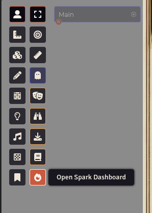
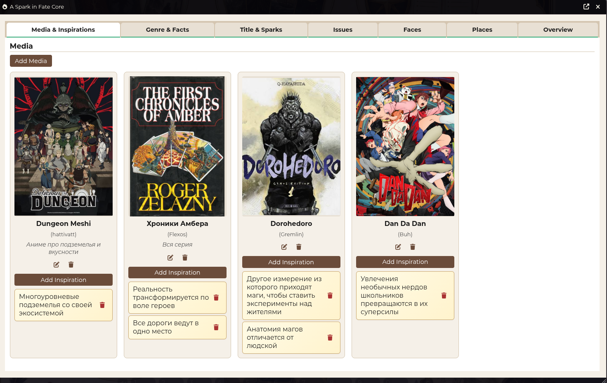
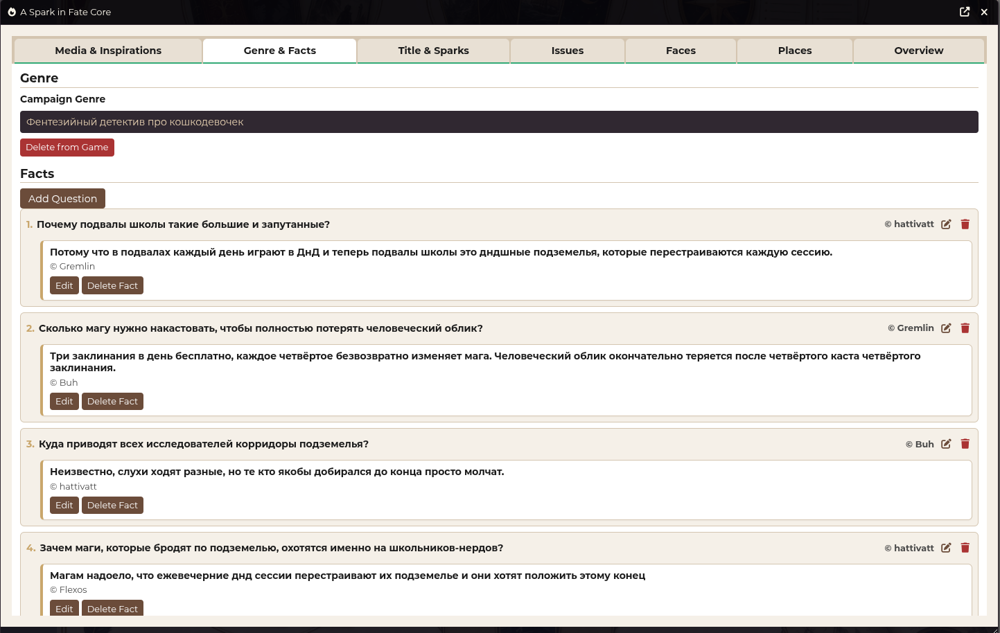
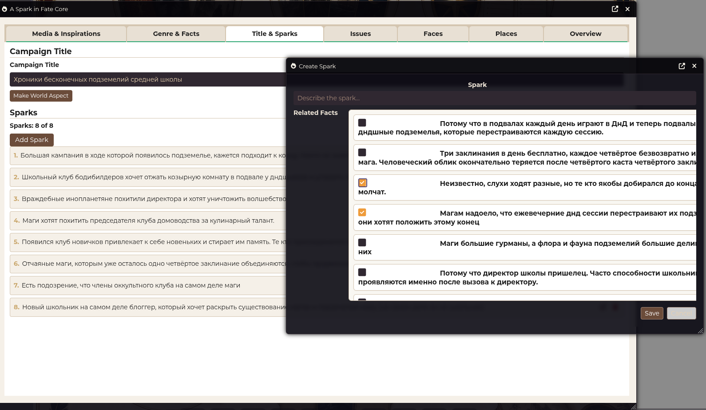
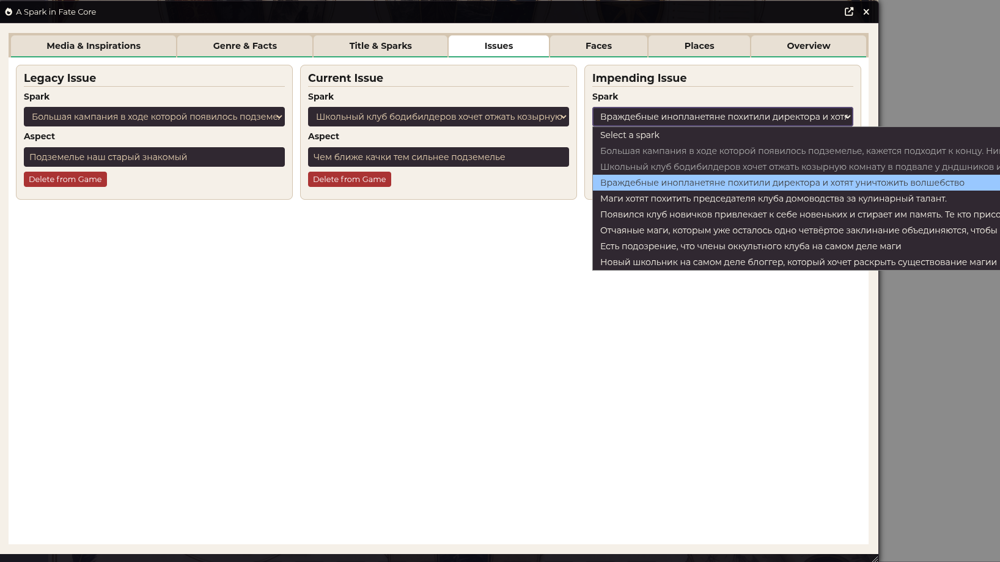
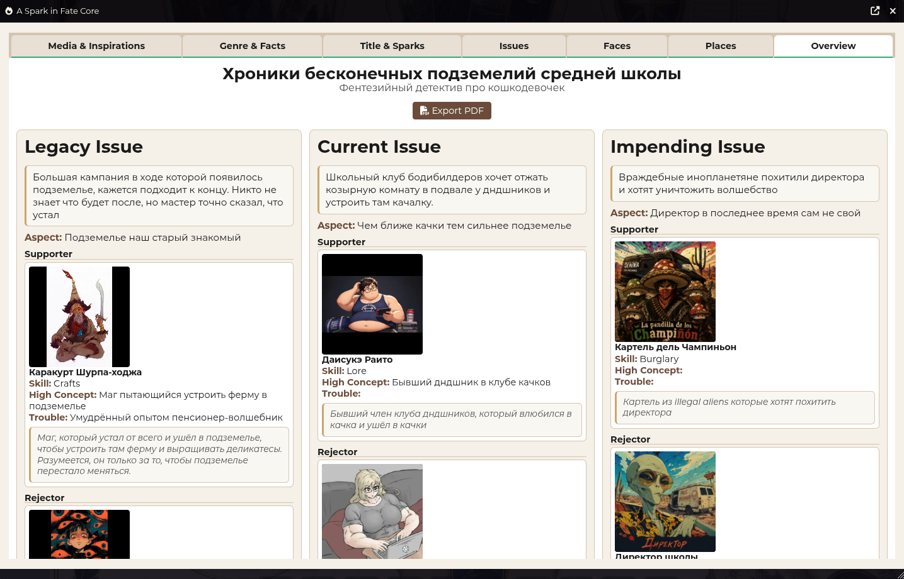

# A Spark in Fate Core

*[Русский](README.ru.md)*

Adds a dashboard for creating a setting using the A Spark in Fate Core system.

## Features

- A convenient dashboard that implements the full setting-creation cycle
- Create and update actors from faces created in the dashboard
- A separate tab with complete information about the created setting
- PDF export (via the browser)

## Usage

Adds a button to the Token Control section that opens the setting creation dashboard.

## Some screenshots

## Localization

Supported languages:

- **English** (`en`)
- **Русский** (`ru`)

## License

MIT
