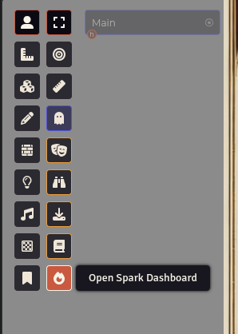
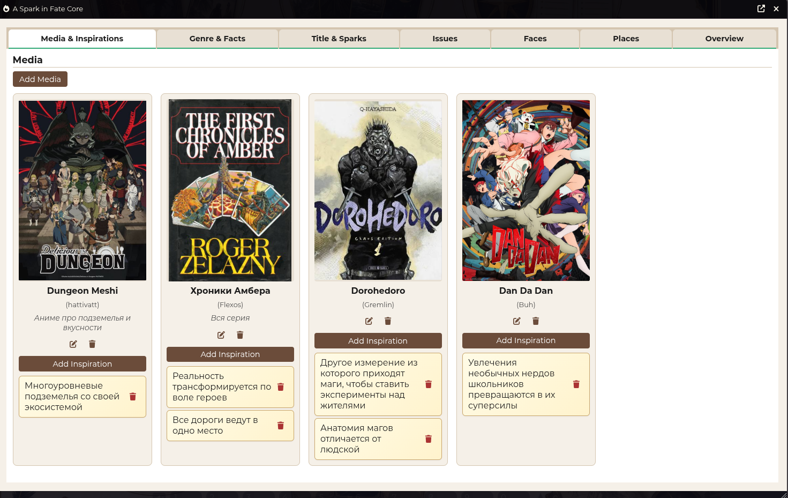
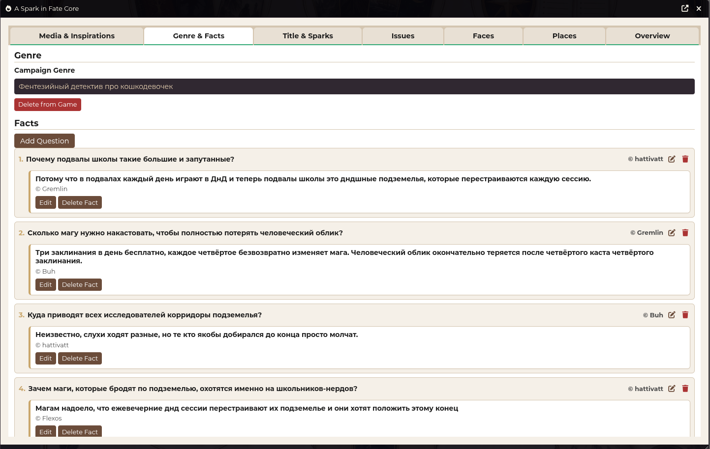
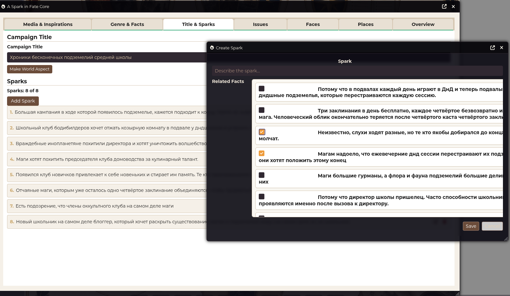
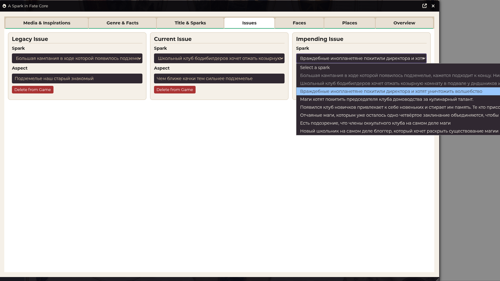
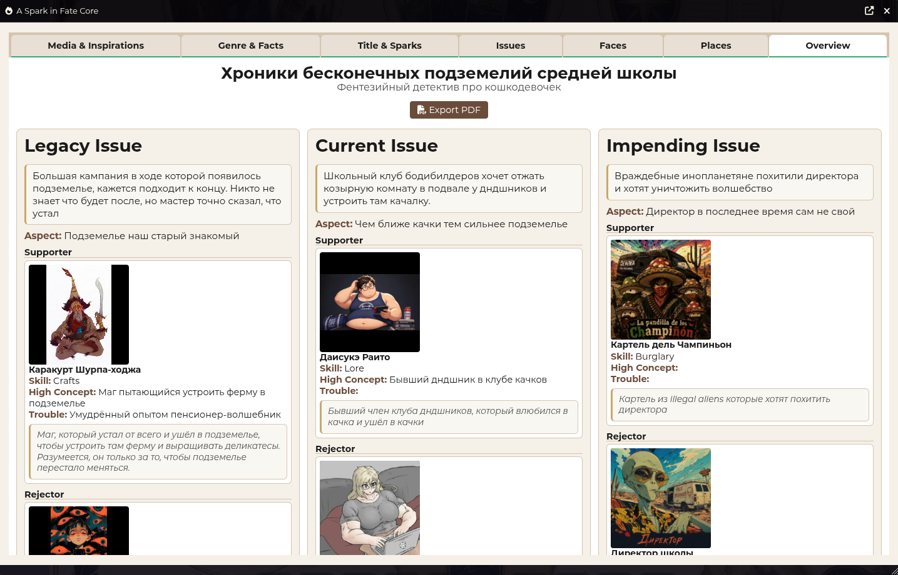

# A Spark in Fate Core

*[English](README.md)*

Добавляет дашборд для создания сеттинга по системе A Spark in Fate Core.

## Особенности
- Удобный дашборд реализующий полный цикл создания сеттинга
- Создание и обновление акторов из созданных в дашборде лиц
- Отдельная вкладка с полной информацией о созданном сеттинге
- Экспорт в pdf (средствами браузера)

## Использование
Добавляет кнопку в раздел Token control, которая открывает дашборд создания сеттинга

## Некоторые скриншоты

## Локализация

Поддерживаемые языки:

- **English** (`en`)
- **Русский** (`ru`)

## Лицензия

MIT
